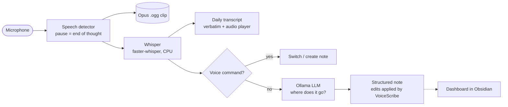

# VoiceScribe for Obsidian

**Think out loud and get organised, sourced notes. Everything runs locally on your own computer.**

VoiceScribe listens to your microphone while you talk through ideas. It transcribes what you say with Whisper, and a local LLM (Ollama) sorts each thought into a structured Obsidian note under theme headings. Every bullet links back to the exact words in the transcript and to the voice clip it came from, similar to NotebookLM's citations. The voice clips are kept as compact Opus audio, about 5 MB per hour of speech.

- **Offline by default.** Audio, transcripts and notes never leave your computer. Downloading Whisper models is opt-in.
- **Built for long brain-dumps.** Speech is split into thoughts at natural pauses, transcribed, and placed into the right section. A thought that corrects an earlier point updates that point.
- **Controlled from inside Obsidian.** A session dashboard, voice commands, focus mode, an in-app guide, and every setting live in Obsidian's settings.

> Platform: Windows 10/11 desktop (macOS and Linux should work with a `venv/bin/python` path, but are untested).

---

## Contents

- [Features](#features)
- [How it works](#how-it-works)
- [Requirements](#requirements)
- [Installation](#installation)
- [Using VoiceScribe](#using-voicescribe)
- [Voice commands](#voice-commands)
- [Focus: add or correct](#focus-add-or-correct)
- [Live or batch organising](#live-or-batch-organising)
- [Pause, undo and summaries](#pause-undo-and-summaries)
- [Importing recordings](#importing-recordings)
- [Links and properties](#links-and-properties)
- [Freeing GPU and memory](#freeing-gpu-and-memory)
- [GPU transcription](#gpu-transcription)
- [Commands and hotkeys](#commands-and-hotkeys)
- [Configuration](#configuration)
- [Files VoiceScribe writes](#files-voicescribe-writes)
- [Troubleshooting](#troubleshooting)
- [Development](#development)
- [Project layout](#project-layout)

---

## Features

| | |
|---|---|
| 🎙 **Continuous capture** | Detects speech by loudness and ends a thought after a natural pause. Very short noise blips are ignored. |
| 📝 **Structured notes** | Each thought becomes concise bullets under `###` theme headings in a `## 💡 Notes` section. Corrections update the existing bullet, and repeated points add a source to it instead of duplicating it. |
| 🔗 **Sources on every bullet** | A small link icon expands on hover to show the time, the transcript quote and a Play button for the voice clip. |
| 🗂 **Choose the note per session** | When you start, pick a new note (named from a template), a recent note or any note. |
| 🗣 **Voice note commands** | "Create a new note named …" or "Switch to Welcome.md" while you talk. |
| 🗂 **Live or batch organising** | Place each thought immediately, or collect thoughts in an inbox and organise them together every few minutes, optionally with a bigger model. |
| ⏸ **Pause, undo, summary** | Pause without ending the session. Say "scratch that" to undo the last change. When you stop, each note gets a summary with action items (checkboxes) and open questions, all linked to their sources. |
| 📥 **Import recordings** | Phone voice memos and other audio files go through the same pipeline. |
| 🕸 **Links & properties** | Mentions of existing notes become `[[links]]`, and notes get `created`, `updated`, `voice_sessions`, `voice_minutes` and a tag. |
| ⚡ **GPU transcription** | Optional NVIDIA GPU support with automatic, crash-safe fallback to the CPU. |
| 🎯 **Focus** | Select a bullet or section and press Alt+F (add details) or Alt+Shift+F (correct it) to steer the model. |
| 📊 **Session dashboard** | Status, a live input meter, a clickable session audio timeline with note-switch markers, counters and a filterable console. |
| 📖 **In-app guide** | Quick start, every voice command, every command and hotkey (including any you've changed), and troubleshooting. |
| 🛡 **Safe edits** | The LLM only suggests where a point goes and how to word it. VoiceScribe applies the edit itself, so the model can never delete or truncate your notes, and your manual edits are kept. |

## How it works



There are two parts:

| Part | Location | Role |
|---|---|---|
| **Backend** | `scribe_router.py` (Python) | Microphone capture, segmentation, transcription, audio archiving, note writing. |
| **Obsidian plugin** | `obsidian_plugin/` (JavaScript) | Starts and stops the backend, dashboard, settings, guide, focus, compact sources. |

The plugin starts the backend as a child process. They talk over JSON lines: status events on stdout (lines starting `@@VS {…}`) and commands such as focus and stop on stdin.

## Requirements

| What | Why |
|---|---|
| [Obsidian](https://obsidian.md) 1.4+ (desktop) | The plugin. |
| Python 3.10+ | The backend (`venv` is created by `Start_Scribe.bat`). |
| [Ollama](https://ollama.com) + a model, e.g. `ollama pull llama3.2:3b` | Organising notes. Optional: without it, thoughts are appended as-is. |
| FFmpeg on `PATH` | Optional. Opus encoding falls back to PyAV, which is installed with faster-whisper. |

A Whisper model (default `large-v3-turbo`, ~1.6 GB) is downloaded once by faster-whisper. VoiceScribe is offline by default, so turn on **Settings → VoiceScribe → Allow model downloads** for the first run, or pre-download the model.

## Installation

VoiceScribe expects the backend folder to sit **next to** your vault. You can point it anywhere in settings.

```
Obsidian Vault/
├── My Vault/                 ← your vault
└── VoiceScribe/              ← this repository
```

1. **Clone the backend next to your vault**

   ```powershell
   cd "C:\path\to\Obsidian Vault"
   git clone https://github.com/<you>/obsidian-voicescribe.git VoiceScribe
   ```

2. **Create the Python environment.** Double-click `Start_Scribe.bat` once. It creates `venv`, installs `requirements.txt` and creates `config.json` from `config.example.json`. Close it when it starts listening.

3. **Install the plugin into your vault**

   ```powershell
   cd VoiceScribe
   .\Install_Plugin.bat "C:\path\to\Obsidian Vault\My Vault"
   ```

   This copies `obsidian_plugin/` to `<vault>/.obsidian/plugins/voicescribe/`.

4. **Enable it** in Obsidian: Settings → Community plugins → enable **VoiceScribe**. The guide opens automatically the first time.

5. **First run checklist** (also in the guide's *Quick start*):
   - Settings → VoiceScribe → **Run checks** (Python packages, FFmpeg, Ollama model).
   - **Calibrate** the microphone: stay quiet for 3 s. This matters, because noise above the threshold gets transcribed into invented text.
   - Turn on **Allow model downloads** for the first recording if the Whisper model isn't on your machine yet, then turn it off again.

If the folder isn't next to your vault, set **Settings → VoiceScribe → Backend → VoiceScribe folder** and, if needed, **Python executable**.

## Using VoiceScribe

1. Press **Alt+V** (or the microphone icon) and choose where the session goes.
2. Talk. Pause naturally; a pause of about 1.7 s ends a thought.
3. Watch the note fill in and the dashboard update. The newest change is highlighted green in the editor.
4. Press **Alt+V** again to stop. VoiceScribe finishes what you already said; press again to force-stop.

### The session dashboard

Opens in the right sidebar when recording starts:

- **Status & timer**, with Start / Stop.
- **Follows the active note.** The note being written opens automatically and follows voice commands. *Pin this note* stops that for the session.
- **Session audio:**
  - a live input meter, with the speech threshold shown as an orange line
  - a timeline of the session: teal for saved speech, blue for processing, grey for silence, purple for a note switch
  - click a segment to play it; hover to see what was heard
- **Counters** for thoughts, transcribed, note updates and the queue.
- **Console** with every status message, filterable by Speech, Notes, Issues and Raw.

### Sources

Each bullet ends with a compact link chip, plus a count when several thoughts support it. Hover it to see each source's time, a **Play** button and the quote from the transcript. Click the time to jump to the transcript. In Live Preview, put the cursor on the chip to edit the underlying links.

## Voice commands

Say a command as its own sentence. At the start or end of a longer thought also works.

| Say | Result |
|---|---|
| "Create a new note named Grocery list" | New note, then switch to it (adds " 2" if the name is taken) |
| "New note called Ideas" | Same |
| "Switch to a new note called Cloud Pro" | Same |
| "Switch to Welcome.md" | Opens an existing note anywhere in the vault (created if missing) |
| "Switch to the Welcome note" · "Go back to Voice Notes" · "Open the note called Mum" | Same |
| "Topic Algorand" · "Note French toast" | Short form of "switch to" |
| "Scratch that" · "Undo that" · "Remove the last point" | Undo the last change to your notes |

Ordinary sentences like "Note that the server is down" or "Switch to talking about elephants" are **not** commands.

## Focus: add or correct

Select part of a note, or just put the cursor on a bullet or `###` heading. Then use one of these modes:

| Keys | Mode | Your next thoughts… |
|---|---|---|
| **Alt+F** | Add details here | are inserted after the focused bullet, or into the focused section |
| **Alt+Shift+F** | Correct this | rewrite only the focused bullet(s). Old sources are kept and the new one is added |

Both are also in the editor's right-click menu. Focus ends when you clear it, switch notes or stop recording.

## Live or batch organising

Choose per session in the start dialog, in settings (*How to organise*), or with the command *Switch organising*.

| Mode | How it works | Good for |
|---|---|---|
| **Live** | Each thought is placed under a theme heading as soon as it's transcribed. | Watching the note take shape; short sessions; Focus corrections. |
| **In batches** | Each thought appears at once in `### 📥 Inbox (to organise)`, with its sources. Every *N* minutes (default 5), when you stop, or via **Organise now**, the model organises the whole inbox together. It merges related thoughts (citing all of them), keeps only corrected versions, and can use a different, bigger model (*Batch: model*). | Long brain-dumps where structure matters more than seeing it live. |

In batch mode:
- **Nothing is lost.** If the model is unavailable, thoughts stay in the inbox. Thoughts the model leaves out go under *Other thoughts*, and pure filler stays only in the transcript.
- **Model output is checked.** Every organised bullet is checked against the thoughts it cites.
- **Undo still works.** "Scratch that" removes the last inbox entry, or undoes the last organising pass.
- **Focus is immediate.** Focus is an explicit instruction, so it always applies straight away.
- **"On this page" list.** Each pass refreshes `## 🧭 On this page` above `## 💡 Notes`: links to every theme (with its point count), the inbox and the session summaries. It's built from the headings themselves, so it takes no model time and always matches the note. It appears once a note has two themes; turn it off with *Batch: "On this page" list*.

**Choosing a batch model.** Batch passes run only every few minutes, so a bigger model that runs partly from system RAM is practical. On a 6 GB GPU with 32 GB RAM, for example:
- best quality: `qwen3:30b-a3b` or `gemma4:26b-a4b` (mixture-of-experts)
- faster: `granite4.2:8b` or `qwen3.5:9b`

In batch mode the session summary also uses this model. VoiceScribe turns off hidden "thinking" for reasoning models (`think: false`; the lowest level for gpt-oss, which can't fully disable it), so they answer directly in JSON.

## Pause, undo and summaries

| | How | What it does |
|---|---|---|
| **Pause** | Alt+P or the dashboard | Stops listening without ending the session. What you were saying is kept, and paused time is shaded on the timeline. |
| **Undo** | Say "scratch that", press Alt+Z, or use the dashboard | Undoes the last thought's change. If you edited the note since, only the points it added are removed. |
| **Summary** | Automatic on stop, or "Summary now" | Adds `## 🧾 Session summary · <date time>` with a short summary, `- [ ]` action items and open questions, each linked to its sources. Re-running replaces that session's summary. |

## Importing recordings

Command palette → **Import an audio recording…** (or the dashboard button when idle). Pick a file from your computer or your vault, then choose the note. The recording is split into thoughts at pauses and processed like live speech: clips, transcript, organised note, voice commands, undo and summary. Supported formats are mp3, m4a, wav, ogg, opus, webm, flac, aac, mp4 and more. Transcript times come from the file's date.

## Links and properties

- **Links.** When a new bullet mentions an existing note, it's linked (`[[Cloud Pro]]`). Multi-word names match in any case; single-word names only match when written exactly like the note. Your own text is never changed.
- **Properties.** Each voice note keeps `created`, `updated`, `voice_sessions`, `voice_minutes` and `tags: [voicescribe]`. Other properties are left alone. Both features can be switched off in settings.

## Freeing GPU and memory

Models only use VRAM/RAM while loaded, and VoiceScribe frees them on its own:

| Model | Freed | Setting (config key) |
|---|---|---|
| Ollama | after *N* idle minutes (default 10), and right after a recording or import ends | *Unload model after* (`ollama_keep_alive_min`; 0 = after every answer, -1 = never) · *Unload models when recording stops* (`unload_on_stop`) |
| Whisper | after *N* minutes without speech in a session, e.g. while paused (default 15), and when the session ends | *Release Whisper after* (`whisper_idle_unload_min`; 0 = never) |

**Model check before processing.** Before each organising step the backend asks Ollama (`/api/ps`) whether the model is loaded. If not, it loads it first and the dashboard shows "loading …". If the model isn't installed you get a notice (`ollama pull …`) and the thought is kept unorganised (in batch mode it stays in the inbox). The plugin also checks that the models are installed before a session starts. Whisper reloads by itself on the next thought.

To free memory immediately, use **Free memory: unload the Ollama models now**, or **Settings → Note organisation → Models in memory → Unload now** (which also shows each loaded model's size and GPU share).

## GPU transcription

`Run Whisper on: Auto` (the default) uses an NVIDIA GPU when it works and the CPU otherwise. On the CPU, transcription takes a few seconds per thought; on a GPU, about one second. The first time, the GPU is tested in a **separate process**, because a missing CUDA library can crash a process outright. The result is cached in `gpu_probe.json`.

To enable it: **Settings → Transcription → Install GPU support…**. A dialog asks where to put NVIDIA's cuBLAS 12 / cuDNN 9 libraries (about 1 GB downloaded once):

| Option | Location |
|---|---|
| This computer only (recommended) | `%LOCALAPPDATA%\VoiceScribe\cuda`. Not synced, which matters when the vault or backend sits in OneDrive / MEGA / Dropbox. |
| VoiceScribe's Python environment | `venv\Lib\site-packages` |
| Another folder… | Any folder, e.g. on a second drive (`pip install --target`) |
| Use CUDA already installed | Point to an existing CUDA 12 `bin` folder; nothing is downloaded |

It shows the free space and warns about synced folders. The choice is stored as `cuda_libs_dir` (*GPU libraries folder* in settings). Then start recording, and use **Check GPU** if the console still says CPU. `int8_float16` keeps memory use low so Ollama fits alongside.

## Commands and hotkeys

| Command | Default hotkey |
|---|---|
| Start / stop recording | Alt+V |
| Focus here: add details to the selection | Alt+F |
| Focus here: correct the selection | Alt+Shift+F |
| Clear focus | — |
| Pause / resume listening | Alt+P |
| Undo the last note change (scratch that) | Alt+Z |
| Write the session summary now | — |
| Organise the inbox now (batch mode) | — |
| Switch organising: live ⇄ in batches | — |
| Free memory: unload the Ollama models now | — |
| Import an audio recording… | — |
| Open session dashboard | — |
| Open active voice note | — |
| Open today's transcript | — |
| Quick options (microphone & models) | Alt+Shift+V |
| Force stop | — |
| Open the guide | — |
| Open settings | — |

Change hotkeys in Obsidian → Settings → Hotkeys (search "VoiceScribe").

## Configuration

All options are in **Settings → VoiceScribe**. They're stored in `VoiceScribe/config.json`, which is shared with the backend and created from `config.example.json`. Changes apply the next time recording starts.

| Group | Settings |
|---|---|
| Dashboard | Note at start (ask / new / last / default), new-note name template (`{date}`, `{time}`), compact sources, open dashboard, follow active note, save session timelines, notices |
| Notes | Default note, notes folder, transcripts folder, audio archive folder |
| Microphone | Device, speech threshold + **Calibrate**, pause length, min / max thought length, minimum real sound, volume normalisation |
| Transcription | Whisper model, GPU / CPU, GPU support (install / check), GPU and CPU compute types, CPU threads, beam size, language, context prompting, silence filter, allow model downloads |
| Organisation | Use LLM, how to organise (live / in batches: interval, batch model, thoughts per pass, batch context and output), Ollama model / host, context window, max output tokens, timeout, minimum words, session summary (+ minimum thoughts), link existing notes, note properties and tag |
| Storage | Opus bitrate (12k ≈ 5 MB/hour) |
| Backend | VoiceScribe folder, Python executable, diagnostics |

The backend can also run without Obsidian: run `Start_Scribe.bat`, configure with `Configure_VoiceScribe.bat`, or see `python scribe_router.py --help`.

## Files VoiceScribe writes

| Path (inside the vault) | Contents |
|---|---|
| `<your note>.md` | `## 💡 Notes` with `###` themes and bullets ending in sources `([[Transcripts/…#^t-HHMMSS\|🔗 time]] · [[…ogg\|▶ Audio]])`. Your own text and other `##` sections are kept. |
| `Transcripts/YYYY-MM-DD_Transcript.md` | Verbatim text per thought, a linkable block id `^t-HHMMSS` and an inline audio player |
| `VoiceScribe_Archives/YYYY-MM-DD/*.ogg` | Opus voice clips (clips with no recognised speech are deleted) |
| `VoiceScribe_Archives/sessions/*.json` | Small loudness timelines for the dashboard |
| Note properties | `created`, `updated`, `voice_sessions`, `voice_minutes`, `tags` |

## Troubleshooting

| Problem | Fix |
|---|---|
| Nothing is transcribed | Check the dashboard console. Run checks. Pick the right microphone and confirm the live meter moves. |
| Sentences appear that you never said ("thanks for watching") | Background noise is being transcribed. **Calibrate**, or raise the speech threshold / minimum real sound. |
| Notes not organised, just appended | Start Ollama and `ollama pull <model>`, or choose an installed model in settings. |
| "Model downloads are disabled" | Turn on *Allow model downloads* once. |
| Slow transcription | Use the GPU (Install GPU support). On the CPU, use a smaller Whisper model (`small.en`), more CPU threads, or beam size 1. |
| No summary | Needs Ollama and at least *Summary: minimum thoughts* thoughts in the note. Force-stop skips it. |
| Stop takes a while | It finishes what you already said. Press stop again to quit immediately. |

The backend log is `VoiceScribe/voicescribe.log`; the dashboard console links to it.

## Development

```powershell
venv\Scripts\python.exe test_voice_scribe.py   # unit tests (no mic/models needed; FFmpeg for the Opus test)
venv\Scripts\python.exe test_pipeline_e2e.py   # full pipeline with a simulated mic, Whisper and LLM
```

The plugin is plain JavaScript (`obsidian_plugin/main.js`), with no build step. After editing, run `Install_Plugin.bat` and reload the plugin in Obsidian.

**Backend → plugin events** (stdout, `@@VS {json}`):
- session: `started`, `listening`, `loading_model`, `model_loaded`, `stats`, `finishing`, `stopped`
- audio: `level`, `speech_start`, `chunk_captured`, `transcribing`, `segment`, `no_speech`, `discarded`
- notes: `heard`, `skipped`, `organising`, `note_updated`, `topic`, `undone`, `summarizing`, `summary_written`
- batch mode: `inbox`, `organising_batch`, `batch_done`, `batch_failed`
- pause, import and GPU: `paused`, `resumed`, `envelope`, `import_progress`, `gpu_check`
- focus: `focus`, `focus_cleared`
- problems: `warning`, `error`

**Plugin → backend commands** (stdin, with `--ipc`): `focus`, `focus_mode`, `clear_focus`, `switch_note`, `undo`, `organise`, `summarize`, `pause`, `resume`, `stop`.

**Other CLI modes:** `--import-audio <file>`, `--calibrate`, `--gpu-status`.

## Project layout

```
├── scribe_router.py          backend: capture, transcription, archiving, note writing
├── obsidian_plugin/          Obsidian plugin (main.js, manifest.json, styles.css)
├── config.example.json       default settings (copied to config.json on first run)
├── list_inputs.py            lists microphones for the settings dropdown
├── config_menu.py            terminal settings menu (used by Configure_VoiceScribe.bat)
├── Start_Scribe.bat          sets up the venv and runs the backend without Obsidian
├── Install_Plugin.bat        copies the plugin into a vault
├── test_voice_scribe.py      unit tests
├── test_pipeline_e2e.py      end-to-end pipeline test
└── CHANGELOG.md
```
